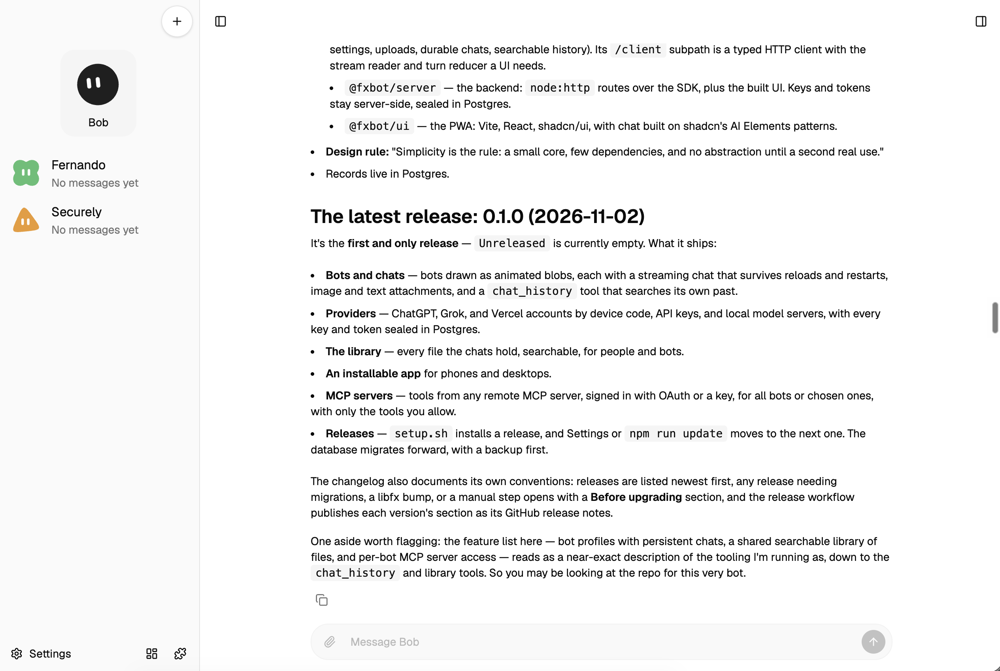

# fxbot

fxbot is a small installable web app for long-running chats with bot profiles. The browser is the UI on desktop and mobile. One Node server runs [libfx](https://fx.sh/docs/lib) and sends each conversation to the provider its bot uses: a ChatGPT, Grok, or Vercel account signed in with a device code, an API key, or a local model server.



Simplicity is the rule: a small core, few dependencies, and no abstraction until a second real use. The core is what every bot needs. Everything else is an add-on that you add only if you want it: a skill, an MCP server, or, once plugins are built, a plugin that changes the app itself. See [CONVENTIONS.md](CONVENTIONS.md#core-or-add-on).

## Stack

A TypeScript monorepo with four npm workspaces under `packages/`, laid out after [eve](https://eve.dev): a core package with a client subpath, a thin server, a UI on the client, and the public site.

| Package | What it is |
| --- | --- |
| [`@fxbot/sdk`](packages/sdk/README.md) | The agent system: providers and their sign-ins, one libfx agent per provider, bot profiles, settings, uploads, each bot's durable chat, and its searchable history. `@fxbot/sdk/client` is a typed client for the server's HTTP API, with the stream reader and the turn reducer a UI needs. |
| `@fxbot/server` | The backend: `node:http` routes over the SDK, and the built UI. Keys and tokens stay here, sealed in Postgres. |
| `@fxbot/ui` | The PWA: Vite, React, and shadcn/ui, with the chat built from shadcn's AI Elements patterns, on `@fxbot/sdk/client`. |
| `@fxbot/website` | The public site and its docs, pre-rendered with Vite, React, and Tailwind into static pages in `out/` by `npm run build-site`. `FXBOT_SITE_BASE` sets the path it is served under. |

Records live in Postgres; libfx keeps each chat's session in files. No Next.js, and no Vercel AI SDK. The packages run as TypeScript source on Node 22.18 or newer, with no build step but the UI's and the site's.

## Phases

In order of execution priority. Checked phases are built. Each is marked **core** or **add-on** ([Core or add-on](CONVENTIONS.md#core-or-add-on)). A core seam is a part of the core that add-ons plug into. Plugins has a full plan, and the rest are one-page stubs until they are planned.

- [x] [v1](docs/_completed/v1-plan.md) (core): bot profiles and a streaming chat
- [x] [Provider logins](docs/_completed/phases/provider-logins.md) (core): ChatGPT, Grok, and Vercel accounts, API keys, and local model servers
- [x] [Library](docs/_completed/phases/library.md) (core): every file the chats hold, for people and bots
- [x] [PWA](docs/_completed/phases/pwa.md) (core): installs on phones and desktops
- [x] [MCP servers](docs/_completed/phases/mcp.md) (core seam): tools from any remote MCP server, with OAuth sign-in
- [x] [Releases](docs/_completed/phases/releases.md) (core): install a release, and update when the next one is ready
- [x] [Add-ons](docs/_completed/phases/addons.md) (core seam): search GitHub's MCP registry, add a server from its page, and update installed ones
- [x] [Skills](docs/_completed/phases/skills.md) (core seam): instructions bots read when a task needs them, from fxbot's list and skills.sh
- [ ] [Plugins](docs/phases/plugins.md) (core: the plugin API): add-ons that change the app, with hooks, tools, data, and screens of their own; chat rooms and herdr first
- [ ] [Memories](docs/phases/memories.md) (core): each bot keeps what it has learned
- [ ] [Cross-bot messaging](docs/phases/cross-bot-messaging.md) (add-on): bots message each other
- [ ] [Knowledge base](docs/phases/knowledge-base.md) (add-on): knowledge the bots draw on
- [ ] [Permissions](docs/phases/permissions.md) (add-on, on a core hook): ask, auto, and yolo modes for tool calls
- [ ] [Bot tools](docs/phases/tools.md) (core, for core data only): host tools bots call during a turn
- [ ] [Web search](docs/phases/web-search.md) (add-on): bots search and read the web, and cite it
- [ ] [Context management](docs/phases/context-management.md) (core): one never-ending chat that fits the model's context window
- [ ] [Past sessions](docs/phases/past-sessions.md) (core): earlier conversations stay browsable
- [ ] [Soul](docs/phases/soul.md) (add-on): a written persona behind each bot's system prompt
- [ ] [Routines](docs/phases/routines.md) (add-on): saved tasks a bot runs on a schedule
- [ ] [Triggers](docs/phases/triggers.md) (add-ons): webhooks and new email start a bot's turn
- [ ] [Chat rooms](docs/phases/chat-rooms.md) (add-on): more than one bot in a conversation, built with plugins
- [ ] [Pages](docs/phases/pages.md) (add-on): reports and guides bots write for reading outside the chat
- [ ] [herdr screen](docs/phases/herdr-screen.md) (add-on): the [herdr](https://herdr.dev) interface in the app, from the herdr plugin
- [ ] [Remote control](docs/phases/remote-control.md) (add-on): heavy work handed to coding agents through herdr
- [ ] [Vault](docs/phases/vault.md) (add-on): saved secrets and details bots use when allowed
- [ ] [1Password](docs/phases/1password.md) (add-on): bots use stored logins and items from 1Password
- [ ] [Image and video generation](docs/phases/media-generation.md) (add-on): bots create images and video
- [ ] [Voice memos](docs/phases/voice-memos.md) (add-on): send a bot a recorded voice memo
- [ ] [Phone calls](docs/phases/phone-calls.md) (add-on): talk with a bot by voice, in the app or over a phone line

The previous design and spike are in [archive/](archive/README.md). The git host may still use the old repository name until the owner renames it.

## Install

On Debian or Ubuntu, `setup.sh` installs the newest release, or the one you name:

```sh
curl -fsSL https://raw.githubusercontent.com/iammrduncan/fxbot/main/setup.sh | sudo bash
curl -fsSL https://raw.githubusercontent.com/iammrduncan/fxbot/main/setup.sh | sudo bash -s -- v0.1.0
```

It installs git and Postgres, and Node 22 from nodejs.org, checked against its checksum, unless the machine has Node 22.18 or newer. Then:
- the `fxbot` user, its Postgres role and database (peer auth, no password), and a key in `/etc/fxbot/secret.key` that only `fxbot` reads
- the release in `/opt/fxbot`: a clone in `repo/`, each installed release in `releases/<tag>/`, and `current` pointing at the running one
- `/etc/fxbot/fxbot.env`, with chats in `/var/lib/fxbot/data` and backups in `/var/lib/fxbot/backups`
- `fxbot.service`, started on 127.0.0.1:8787

Running it again finishes an install that stopped, and leaves a working one alone. It stops, and says why, if another fxbot already holds its names: a database `fxbot`, a key in `/etc/fxbot`, or port 8787. A checkout's `npm run dev` stays clear of them ([Run from a checkout](#run-from-a-checkout)), so both can run on one machine.

### Reaching it

fxbot listens on 127.0.0.1:8787 and has no login of its own. On the machine itself, open `http://127.0.0.1:8787`: everything works there, installing the app included.

From your other devices, [Tailscale](https://tailscale.com) is the recommended way. It adds HTTPS, which a phone needs to install the app, and only your own devices can reach fxbot. Give it the machine's own address:

```sh
sudo tailscale serve --bg 8787       # https://<machine>.<tailnet>.ts.net
```

Or a name of its own, `bot.<tailnet>.ts.net`, as a [Tailscale Service](https://tailscale.com/kb/1552/tailscale-services). The machine must be tagged, and a tailnet admin does three things once:
1. **Define the service** on the admin console's Services page: **Define a Service**, named `bot`, with the port `tcp:443`.
2. **Approve this machine** as its host on that service's page, or with an `autoApprovers` rule for the machine's tag.
3. **Grant access** in the policy file, such as `{ "src": ["autogroup:member"], "dst": ["svc:bot"], "ip": ["443"] }`.

Then, on the machine:

```sh
sudo tailscale serve --service=svc:bot --https=443 http://127.0.0.1:8787
```

Check the address from a phone or laptop on the tailnet, not from the machine itself: a grant to people doesn't cover a tagged machine, so the name may not resolve there.

Anything else in front of fxbot, such as a reverse proxy or another VPN, works if it:
- **adds its own login or access control.** Whoever reaches fxbot can use all of it: every bot, chat, and provider.
- **serves HTTPS,** which installing the app needs, and which lets an MCP server's sign-in come back to fxbot by itself.
- **passes the `Host` header through unchanged.** fxbot refuses a write whose page origin doesn't match the host it was reached at.
- **doesn't buffer responses,** since each chat streams its replies.

Never open port 8787 to a network directly.

Open the address on each device and install the app from it: Install in Settings on Chrome or Edge, or Share and then Add to Home Screen on an iPhone. The app opens offline, and offers Reload when an update lands.

## Update

When a newer release is out, Settings shows its notes and an **Update** button. fxbot builds the new release beside the running one, switches `current` to it, lets running chats finish, and restarts. From a shell:

```sh
cd /opt/fxbot/current && sudo -u fxbot -H npm run update    # the newest release, or name one: -- v0.2.0
sudo systemctl restart fxbot
```

- **Migrations.** Each release's database changes are numbered files in `packages/sdk/src/migrations/`. A starting server runs the ones the database hasn't, all or none. It first backs up the database and the chat files into `FXBOT_BACKUPS`, and keeps the last five.
- **Prereleases,** such as `v0.2.0-rc.1`, install only by name.
- **Going back.** With no migration in between, point `current` at the older release and restart:

  ```sh
  sudo ln -sfn releases/v0.1.0 /opt/fxbot/current && sudo systemctl restart fxbot
  ```

  After a migration, the older release refuses the database. Restore the backup taken before it, then switch:

  ```sh
  sudo systemctl stop fxbot
  sudo -u fxbot pg_restore --clean --if-exists -d fxbot /var/lib/fxbot/backups/<date>-before-<migration>/database.dump
  sudo -u fxbot tar -xzf /var/lib/fxbot/backups/<date>-before-<migration>/data.tar.gz -C /var/lib/fxbot/data
  sudo ln -sfn releases/v0.1.0 /opt/fxbot/current && sudo systemctl start fxbot
  ```

## Run from a checkout

Node 22.18 or newer, and Postgres. From the repository root:

```sh
npm install
npm run dev      # the page on 127.0.0.1:5173 and the API on 8788, reloading on any change
npm run prod     # build the page, then serve it and the API on 127.0.0.1, port FXBOT_PORT
npm run server   # only the API and the last build, on the same port
```

The server reads these from the environment, or from an uncommitted `.env` in the repository root; the environment wins. Only the server reads `.env`, and none of these is itself a secret.

| Variable | What it is |
| --- | --- |
| `FXBOT_DATABASE_URL` | Required. fxbot's Postgres, such as `postgres:///fxbot_dev` with `PGHOST=/var/run/postgresql`: the local socket with peer auth, so no password |
| `FXBOT_PORT` | The API's port on 127.0.0.1. Default 8787, a release install's; `npm run dev` uses 8788 unless this is set in the shell |
| `FXBOT_SECRET_KEY_FILE` | Required. A file outside the repo with 32 random bytes in base64. It seals every key and token fxbot stores |
| `FXBOT_VERCEL_CLIENT_ID` | Optional. fxbot's own Vercel OAuth app, for signing in with a Vercel account |
| `FXBOT_DATA` | Where libfx keeps each chat's session files. Default `./data` |
| `FXBOT_CLIENT_METADATA_URL` | Optional. The project's published OAuth client document, for MCP servers that sign in with one. Without it, fxbot registers itself with each server |
| `FXBOT_MCP_REGISTRY` | Optional. The MCP registry that fxbot mirrors hourly for search, and that registry entries come from. Default GitHub's, `https://api.mcp.github.com` |
| `FXBOT_MCP_EVERYTHING` | Optional. The registry that Search everything asks, once per search. Default the official one, `https://registry.modelcontextprotocol.io` |
| `FXBOT_LISTS_URL` | Optional. The site that publishes fxbot's own lists of MCP servers and skills, such as `https://<domain>`. fxbot reads its `mcp-registry.json` and `skills-registry.json` hourly. Without it, the lists the release shipped with |
| `FXBOT_BACKUPS` | Where the database and chat files are backed up before migrations run. Default `./backups` |
| `FXBOT_UPDATE_CHECK` | `off` stops the daily check for a newer release, which asks GitHub about the repository in `package.json` |
| `FXBOT_RELEASES_URL` | Optional. Where that check reads the newest release, in the shape of GitHub's `releases/latest`, for a fork or a mirror |

One-time setup on Debian, for a checkout you run as yourself. Its names stay clear of a release install's (`fxbot`, `/etc/fxbot`, port 8787), so both can run on one machine. For everyday use, install a release instead: there the server runs as its own user.

```sh
sudo apt install postgresql
sudo -u postgres createuser "$USER"
sudo -u postgres createdb -O "$USER" fxbot_dev        # peer auth: you connect as your own role
sudo install -d -o "$USER" -m 700 /etc/fxbot-dev
openssl rand -base64 32 > /etc/fxbot-dev/secret.key && chmod 400 /etc/fxbot-dev/secret.key
printf '%s\n' FXBOT_DATABASE_URL=postgres:///fxbot_dev PGHOST=/var/run/postgresql FXBOT_SECRET_KEY_FILE=/etc/fxbot-dev/secret.key > .env
```

Then add providers in Settings: a ChatGPT, Grok, or Vercel account by device code, an API key, or a local server such as Ollama. The page sends a key once and never gets it back. To seal everything under a new key, stop the server and run `npm run rotate-key -- <new key file>`, then point `FXBOT_SECRET_KEY_FILE` at that file.

`npm run prod` is the production build on its own: it builds the page into `packages/ui/dist/`, then serves it and `/api`. The API that `npm run dev` starts serves the last build there too. On a machine with a release install, give either another port than 8787 with `FXBOT_PORT`.

To reach the development page from your other devices, serve it on your tailnet, with HTTPS:

```sh
tailscale serve --bg 5173                 # npm run dev, at https://<machine>.<tailnet>.ts.net
```

An app installed from that address is the development page, so every change shows up as it lands, but it cannot open while `npm run dev` is down. fxbot has no login of its own, so do not expose its ports any other way.

## Releasing

`main` holds releases only, and every commit on it is one. Work happens on `release/<next version>`, made from `main` after each release; `npm run dev` runs from that branch. When the branch is ready:

```sh
npm version 0.2.0 --no-git-tag-version     # package.json and the lockfile
# CHANGELOG.md: rename "## Unreleased" to "## 0.2.0 (<date>)", with a Before upgrading list if it adds migrations
git commit -am "Release 0.2.0"
git switch main && git merge --ff-only release/0.2.0 && git push
git switch -c release/0.3.0 && git push -u origin release/0.3.0
```

The [release workflow](.github/workflows/release.yml) typechecks and builds the new version, checks that no shipped migration changed, then tags it and publishes a GitHub Release with its changelog section. It runs only on `main`: release branches are for work, and never publish. A prerelease, such as `0.3.0-rc.1`, is published only when you merge one into `main`. A fix to a release goes on `release/0.2.1` from `main`, and is merged into the open release branch after.

## Status

v1 is built: bot profiles drawn as animated blobs, a streaming chat that survives reloads and server restarts, image and text file attachments, and an installable shell that opens offline. [Provider logins](docs/_completed/phases/provider-logins.md) is built too: device code sign-in, API keys and local servers, model discovery, sealed secrets in Postgres, and provider switches that carry a summary over. The [library](docs/_completed/phases/library.md) is built as well: one copy of every file the chats hold, images and text files sent and documents a bot saves, each tagged with the bots and chats it came from. The bento button beside Settings opens it across every bot, with search and filters, and a panel beside each chat shows that bot's own. Bots search, read, and save it through three tools. [MCP servers](docs/_completed/phases/mcp.md) are built: the puzzle button beside the library adds a remote server by its address, signs in with OAuth or takes a key, and gives the tools you allow (the read-only ones to start) to all bots or the bots you choose. [Add-ons](docs/_completed/phases/addons.md) put a search above that page's tabs: fxbot mirrors GitHub's MCP registry hourly, opens each entry's page before adding it, and marks an installed server that has a newer version, is deprecated, or was removed, and updates it only when asked. [Skills](docs/_completed/phases/skills.md) come from fxbot's own list and skills.sh, pinned to a commit of their GitHub repository: each bot sees a short list of its skills, and a `skill` tool reads one when a task needs it. In a chat, `$` or `/` picks one to send with a message. The [PWA phase](docs/_completed/phases/pwa.md) made fxbot an app to install from the tailnet address: Chrome's own Install button, the steps on an iPhone, and room for the notch, the home indicator, and the keyboard. The production build also opens offline, and its new builds wait for Reload. [Releases](docs/_completed/phases/releases.md) are built: `setup.sh` installs a tagged release, Settings updates to the next with one button, and the database moves forward through numbered migrations, backed up first. All of it was checked against mock servers, stubbed sign-in services, and Chromium on this machine, not with real accounts, models, or phones. The [v1 plan](docs/_completed/v1-plan.md) and the phase pages record what was checked.

## License

[Apache License 2.0](LICENSE). The vendored `show-me` skill in `.agents/skills/` keeps its own MIT license.
